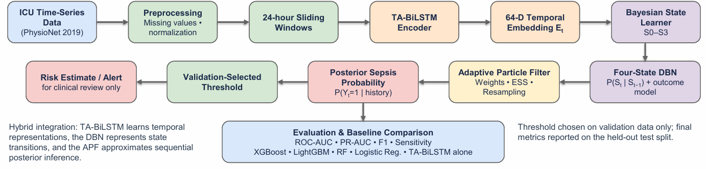
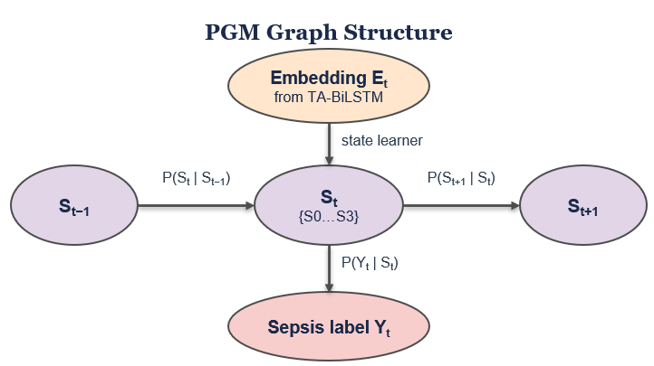
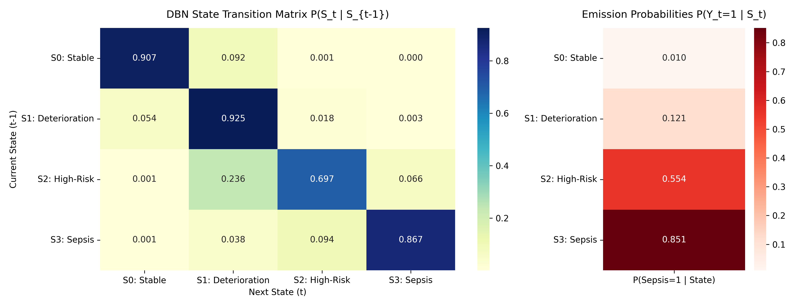
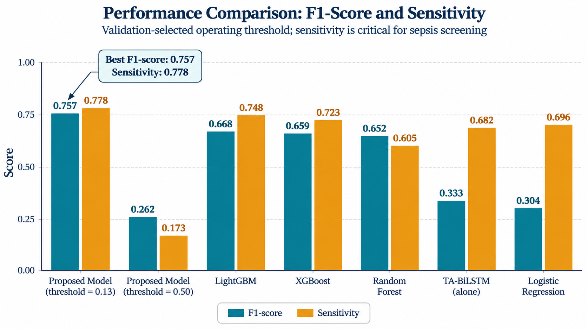
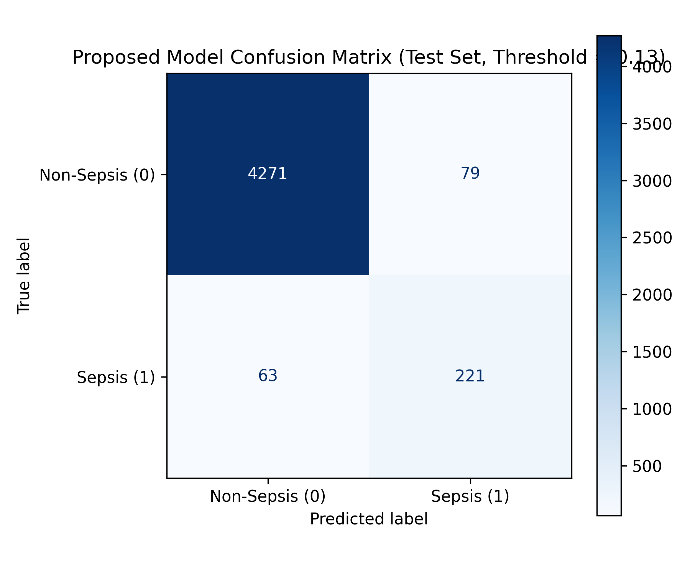
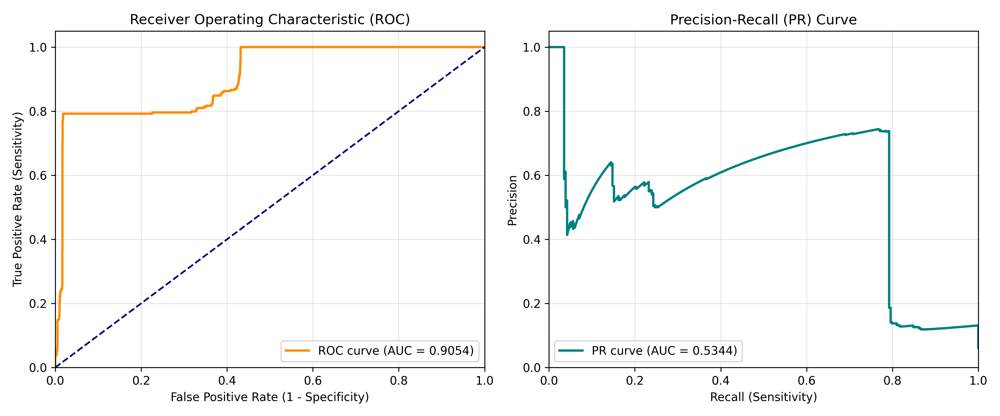

# Adaptive Bayesian TA-BiLSTM for Early Sepsis Prediction


An end-to-end temporal and probabilistic framework for early sepsis detection in Intensive Care Unit (ICU) patients. This project integrates a **Temporal Attention-based Bidirectional Long Short-Term Memory (TA-BiLSTM)** encoder, a supervised **Bayesian State Learner**, a 4-state **Dynamic Bayesian Network (DBN)**, and an **Adaptive Particle Filter (APF)** to model patient deterioration trajectories and track sepsis risk with principled uncertainty quantification.

Developed as the course capstone project for **22AIE301: Probabilistic Reasoning** at Amrita Vishwa Vidyapeetham.

---

## Table of Contents

- [Overview](#overview)
- [System Workflow](#system-workflow)
- [Architecture & PGM Formulation](#architecture--pgm-formulation)
- [Hidden Clinical States](#hidden-clinical-states)
- [Sequential Inference (Adaptive Particle Filter)](#sequential-inference-adaptive-particle-filter)
- [Dataset & Preprocessing](#dataset--preprocessing)
- [Experimental Results](#experimental-results)
- [Repository Structure](#repository-structure)
- [Quickstart & Execution Guide](#quickstart--execution-guide)
- [Important Notes & Clinical Limitations](#important-notes--clinical-limitations)
- [Team Members & Acknowledgments](#team-members--acknowledgments)
- [References](#references)

---

## Overview

Sepsis is a life-threatening medical emergency caused by a dysregulated systemic host response to infection, leading to rapid tissue hypoperfusion, sequential organ dysfunction, septic shock, and death. Because mortality increases by **7% to 8% for every single hour of delay** in administering targeted antibiotics, early warning is crucial.

### The Challenge & Research Gap
1. **Dynamic & Noisy Time Series:** ICU patient measurements (vitals and lab work) are multivariate, irregularly sampled, noisy, and contain extreme rates of missingness.
2. **Shortcomings of Heuristic Scores:** Conventional clinical scores (such as SIRS, SOFA, and qSOFA) are static, reactive, and often alert after substantial organ damage has already transpired.
3. **Limitations of Black-Box Deep Learning:** Standard machine learning and recurrent networks provide point predictions without modeling the underlying stages of physiological disease progression or accounting for sequential uncertainty.

### Our Solution
This project establishes a hybrid framework that bridges deep representation learning with probabilistic graphical models (PGMs):
- Learns 64-dimensional temporal embeddings from 24-hour multivariate ICU windows using a **TA-BiLSTM**.
- Maps embeddings into **4 discrete, clinically interpretable hidden states** ($S_0$ to $S_3$) using a supervised Bayesian State Learner trained with Focal Loss.
- Models physiological state transitions and disease progression over time using a **Dynamic Bayesian Network (DBN)**.
- Recursively tracks and updates posterior sepsis risk in real time using an **Adaptive Particle Filter (APF)** with Effective Sample Size (ESS) resampling.
- Calibrates the decision threshold ($\tau = 0.13$) using validation data to address severe class imbalance.

---

## System Workflow

```text
       Multivariate ICU Time-Series Data (PhysioNet CinC 2019)
             [40 Clinical Features: Vitals, Labs, Demographics]
                                     │
                                     ▼
                Missingness Masking & Normalization
                                     │
                                     ▼
                    24-Hour Sliding Windows (24 × 40)
                                     │
                                     ▼
                 Temporal Attention BiLSTM (TA-BiLSTM)
                                     │
                                     ▼
                     64-D Latent Embedding Vector (Et)
                                     │
                                     ▼
               Supervised Bayesian State Learner (Focal Loss)
                                     │
                                     ▼
            4 Hidden Clinical States: S0, S1, S2, S3
                                     │
                                     ▼
                 Dynamic Bayesian Network (DBN)
             Transition: P(St | St-1)  |  Emission: P(Yt | St)
                                     │
                                     ▼
                  Adaptive Particle Filter (APF)
           [200 Particles | Weight Update | ESS Resampling]
                                     │
                                     ▼
              Posterior Sepsis Probability: P(Yt = 1 | E1:t)
                                     │
                                     ▼
             Validation-Calibrated Threshold (τ = 0.13)
                                     │
                                     ▼
                  Calibrated Early Sepsis Alert
```

---

## Architecture & PGM Formulation

### 1. Overall Framework Architecture


The pipeline processes continuous ICU data through sequence segmentation, neural feature abstraction, probabilistic state estimation, and sequential Bayesian tracking.

### 2. Probabilistic Graphical Model Structure


Let:

- **Observation window** `X_t`: The 24-hour observation window, represented by a matrix of 24 hourly time steps and 40 features per time step (`24 × 40`).
- **Temporal embedding** `E_t = f_theta(X_t)`: The 64-dimensional temporal embedding extracted by the TA-BiLSTM encoder, parameterized by `theta` (`E_t ∈ R^64`).
- **Hidden clinical state** `S_t ∈ {S_0, S_1, S_2, S_3}`: The discrete hidden clinical state at time window `t`, with four possible states.
- **Sepsis outcome** `Y_t ∈ {0, 1}`: The binary sepsis outcome label, where `Y_t = 1` indicates sepsis and `Y_t = 0` indicates no sepsis.


TThe joint distribution factorizes as a first-order hidden Markovian temporal model:

```math
P(S_{1:T}, Y_{1:T}, \mathbf{E}_{1:T}) = P(S_1) \prod_{t=1}^{T} P(\mathbf{E}_t \mid S_t)\, P(Y_t \mid S_t) \prod_{t=2}^{T} P(S_t \mid S_{t-1})
```

The evidence $\mathbf{E}_t \to S_t$ is learned via the supervised Bayesian State Learner, producing the posterior state distribution used for particle weighting.

---

## Hidden Clinical States

The model stratifies ICU patients into four physiologically meaningful stages:

| State | Clinical Definition | Initial Prob $P(S_1)$ | Sepsis Emission $P(Y_t=1 \mid S_t)$ | Clinical Interpretation |
| :--- | :--- | :---: | :---: | :--- |
| **$S_0$** | **Stable / Low-Risk** | **63.37%** | **0.97%** ($0.0097$) | Vitals and lab markers are within normal baseline ranges. Negligible sepsis risk. |
| **$S_1$** | **Mild Deterioration** | **34.09%** | **12.12%** ($0.1212$) | Subclinical abnormalities (mild tachycardia, mild tachypnea, slight temperature fluctuations). |
| **$S_2$** | **High-Risk Pre-Sepsis** | **1.21%** | **55.35%** ($0.5535$) | Impending shock and organ hypoperfusion (elevated lactate, hypotension, altered WBC). |
| **$S_3$** | **Severe Sepsis** | **1.33%** | **85.13%** ($0.8513$) | Manifest clinical sepsis meeting Sepsis-3 diagnostic criteria; acute organ failure. |

### Learned DBN Transition & Emission Matrices


#### State Transition Matrix $P(S_t \mid S_{t-1})$
```text
           Next S0     Next S1     Next S2     Next S3
State S0    0.9073      0.0917      0.0007      0.0004
State S1    0.0536      0.9254      0.0179      0.0031
State S2    0.0011      0.2364      0.6969      0.0655
State S3    0.0009      0.0376      0.0945      0.8670
```
- **Stability:** Both $S_0$ ($90.73\%$) and $S_1$ ($92.54\%$) exhibit high temporal self-persistence.
- **Deterioration Dynamics:** From high-risk state $S_2$, patients have a **6.55% per-window transition directly into full sepsis $S_3$**, but can also improve back to $S_1$ ($23.64\%$) under clinical care.

---

## Sequential Inference (Adaptive Particle Filter)

To track the posterior sepsis probability in real time without assuming Gaussianity, an **Adaptive Particle Filter (APF)** is employed:

1. **Initialization:** Sample $N = 200$ particles $\{s_0^{(i)}\}_{i=1}^N$ according to the initial state distribution $\boldsymbol{\pi}$, with uniform weights $w_0^{(i)} = \frac{1}{N}$.
2. **Prediction (Time Update):** Propagate particles using the DBN transition matrix:
   $$s_t^{(i)} \sim P(S_t \mid S_{t-1} = s_{t-1}^{(i)})$$
3. **Correction (Measurement Update):** Update particle importance weights based on observation state likelihood:
   $$\tilde{w}_t^{(i)} = w_{t-1}^{(i)} \cdot P(S_t^{\text{obs}} \mid s_t^{(i)}) \cdot P(Y_t \mid s_t^{(i)})$$
   Normalize weights: $w_t^{(i)} = \frac{\tilde{w}_t^{(i)}}{\sum_{j=1}^N \tilde{w}_t^{(j)}}$.
4. **Degeneracy Monitoring:** Compute the Effective Sample Size (ESS):
   $$N_{\text{eff}} = \frac{1}{\sum_{i=1}^N \left(w_t^{(i)}\right)^2}$$
5. **Systematic Adaptive Resampling:** When $N_{\text{eff}} < \frac{N}{2} = 100$, resample particles to eliminate low-weight particles and replenish the particle diversity.
6. **Posterior Risk Estimate:**
   $$P(Y_t = 1 \mid \mathbf{E}_{1:t}) = \sum_{i=1}^N w_t^{(i)} P(Y_t = 1 \mid S_t = s_t^{(i)})$$

---

## Dataset & Preprocessing

The model is trained and verified on the public **PhysioNet/Computing in Cardiology Challenge 2019** dataset:
- **Total Patients:** 40,336 ICU stays across two distinct hospital networks.
- **Variables (40 features per hour):**
  - **Vitals (8):** Heart Rate, O2 Saturation, Temperature, SBP, MAP, DBP, Respiration Rate, EtCO2.
  - **Laboratory Measures (26):** Blood glucose, lactate, creatinine, bilirubin, platelets, WBC, hemoglobin, BUN, arterial blood gases, etc.
  - **Demographics & Admission (6):** Age, Gender, ICU unit type (Unit 1/Unit 2), Hospital Admission Time, ICU Length of Stay.
- **Sliding Window Construction:** 24-hour sequence lengths ($L = 24$), yielding:
  - **Training sequences:** 52,366
  - **Validation sequences:** 6,050
  - **Test sequences (held-out):** 6,051
  - **Total sequences:** 64,467
- **Labeling Protocol:** Sepsis positive labels ($Y_t = 1$) are set starting 6 hours before clinical onset to reward prospective early detection.

---

## Experimental Results

### Test Set Performance Comparison

The proposed framework was benchmarked against standard tabular baselines and recurrent neural networks on identical held-out test data:

| Model | ROC-AUC | PR-AUC | F1-Score | Accuracy | Sensitivity (Recall) | Specificity | Precision |
| :--- | :---: | :---: | :---: | :---: | :---: | :---: | :---: |
| **Proposed Bayesian Model ($\tau = 0.13$)** | **0.9054** | **0.5344** | **0.7568** | **96.94%** | **77.82%** | **98.18%** | **73.67%** |
| LightGBM | 0.9314 | 0.7476 | 0.6680 | 94.60% | 74.77% | 96.15% | 60.37% |
| XGBoost | 0.9317 | 0.7500 | 0.6591 | 94.56% | 72.27% | 96.31% | 60.57% |
| Random Forest | 0.9291 | 0.6923 | 0.6520 | 95.31% | 60.45% | 98.04% | 70.74% |
| TA-BiLSTM (alone, $\tau = 0.50$) | 0.8289 | 0.4127 | 0.3328 | 80.12% | 68.18% | 81.06% | 22.01% |
| LSTM (alone, $\tau = 0.50$) | 0.7857 | 0.3793 | 0.3149 | 83.24% | 52.95% | 85.62% | 22.40% |
| Baseline Logistic Regression | 0.7997 | 0.3408 | 0.3042 | 76.86% | 69.55% | 77.44% | 19.47% |



### Key Insights
1. **F1-Score and Precision Surge:** Combining the TA-BiLSTM embedding with the DBN state filter and Particle Filter drastically improves precision ($73.67\%$) and F1-score ($0.7568$) compared to raw deep learning models ($0.31 - 0.33$).
2. **Threshold Calibration ($\tau = 0.13$):** Under default $\tau = 0.50$, severe class imbalance causes recurrent models to miss most sepsis events (sensitivity $< 20\%$). Optimizing the threshold to $0.13$ on validation data balances the precision-recall trade-off and unlocks **$77.82\%$ sensitivity with $98.18\%$ specificity**.

### Confusion Matrix & Curves (Test Split)
| Confusion Matrix (Patient Level) | ROC & Precision-Recall Curves |
| :---: | :---: |
|  |  |

---

## Repository Structure

```text
sepsis-prediction-hybrid-model/
├── Images/
│   ├── overall_architecture.png           # End-to-end framework architecture diagram
│   ├── pgm_structure.png                  # Probabilistic Graphical Model structure
│   ├── state_transition_and_emission.png  # Heatmaps of transition and emission matrices
│   ├── model_performance_comparison.png   # Benchmark comparison bar chart
│   ├── confusion_matrix.png               # Final test set confusion matrix
│   └── roc_pr_curve.png                   # Receiver operating and precision-recall curves
├── Main_Methodology/
│   ├── 01_Data_Preparation/
│   │   ├── prepare_sliding_sequences.py   # Extracts 24-hr windows from patient CSVs
│   │   ├── convert_sliding_to_memmap.py   # Memory-mapped array conversion
│   │   └── create_combined_memmap.py      # Combines data and mask into binary format
│   ├── 02_TA_BiLSTM/
│   │   ├── train_sliding_lstm_encoder_memmap.py # Trains TA-BiLSTM encoder
│   │   └── extract_sliding_embeddings.py        # Extracts 64-D temporal embeddings
│   ├── 03_Bayesian_State_Learner/
│   │   ├── train_state_learner_sliding.py # Learns supervised states via Focal Loss
│   │   └── state_learner_sliding.pt       # Trained state learner model weights
│   ├── 04_Dynamic_Bayesian_Network/
│   │   ├── dbn_supervised_temporal.py     # Estimates initial, transition & emission matrices
│   │   ├── transition_matrix_supervised.csv # 4x4 state transition matrix
│   │   ├── emission_probability_supervised.csv # Sepsis emission likelihood per state
│   │   └── initial_probability.csv        # Prior state distribution
│   ├── 05_Adaptive_Particle_Filter/
│   │   ├── adaptive_particle_filter.py    # Sequential Monte Carlo particle filter
│   │   └── optimize_threshold.py          # Validation-based threshold tuning
│   └── 06_Final_Results/
│       ├── optimized_metrics.csv          # Evaluated test metrics at optimal threshold
│       └── optimized_patient_predictions.csv # Patient-level predictions and probabilities
├── Other_Models/                          # Baseline implementations
│   ├── LightGBM/lightgbm_model.py
│   ├── XGBoost/xgboost_model.py
│   ├── Random_Forest/random_forest.py
│   ├── Logistic_Regression/logistic_regression.py
│   ├── LSTM/train_lstm_encoder.py
│   ├── TA_BiLSTM/train_ets_bilstm.py
│   └── Results/final_model_comparison.csv # Baseline evaluation metrics summary
├── 22AIE301_Final_Review.pptx             # Final review slide presentation
├── paper.pdf                              # Full IEEE-format research paper manuscript
├── PhysioNet_2019_Sepsis_Dataset_Description (1).txt # Raw dataset specification
├── requirements.txt                       # Python dependencies
├── .gitignore                             # Git ignore rules for data and checkpoints
└── README.md                              # Project documentation
```

---

## Quickstart & Execution Guide

### 1. Clone the Repository
```bash
git clone https://github.com/Saampotth2211/sepsis-prediction-hybrid-model.git
cd sepsis-prediction-hybrid-model
```

### 2. Set Up Virtual Environment
```bash
# Windows
python -m venv .venv
.venv\Scripts\activate

# Linux / macOS
python3 -m venv .venv
source .venv/bin/activate
```

### 3. Install Required Dependencies
```bash
pip install --upgrade pip
pip install -r requirements.txt
```

### 4. Running the Main Methodology Pipeline
To execute the pipeline end-to-end, run the numbered scripts in sequence:

```bash
# Step 1: Prepare 24-hour sliding sequence windows
python Main_Methodology/01_Data_Preparation/prepare_sliding_sequences.py
python Main_Methodology/01_Data_Preparation/convert_sliding_to_memmap.py
python Main_Methodology/01_Data_Preparation/create_combined_memmap.py

# Step 2: Train the Temporal Attention BiLSTM and extract 64-D embeddings
python Main_Methodology/02_TA_BiLSTM/train_sliding_lstm_encoder_memmap.py
python Main_Methodology/02_TA_BiLSTM/extract_sliding_embeddings.py

# Step 3: Train the Supervised Bayesian State Learner
python Main_Methodology/03_Bayesian_State_Learner/train_state_learner_sliding.py

# Step 4: Estimate Dynamic Bayesian Network (DBN) parameters
python Main_Methodology/04_Dynamic_Bayesian_Network/dbn_supervised_temporal.py

# Step 5: Run Adaptive Particle Filtering and optimize decision threshold
python Main_Methodology/05_Adaptive_Particle_Filter/adaptive_particle_filter.py
python Main_Methodology/05_Adaptive_Particle_Filter/optimize_threshold.py
```

> **Note on Data Path:** Set the environment variable `SEPSIS_PROJECT_DIR` to specify your custom data storage directory if different from the workspace default:
> ```bash
> export SEPSIS_PROJECT_DIR="/path/to/your/data"   # Linux/macOS
> set SEPSIS_PROJECT_DIR=C:\path\to\your\data       # Windows CMD
> $env:SEPSIS_PROJECT_DIR="C:\path\to\your\data"   # Windows PowerShell
> ```

---

## Important Notes & Clinical Limitations

- **Research Decision Support Prototype:** This project is designed as an investigative decision-support research model. It is **not** an autonomous diagnostic device and should never replace licensed clinical judgment.
- **Threshold Dependency:** Sepsis detection metrics are heavily dependent on the chosen operational threshold. A threshold of $\tau = 0.13$ was selected to maximize the F1-score and sensitivity in an ICU setting where missing a true sepsis event (false negative) is far more hazardous than a false alarm.
- **Cohort Generalization:** The model was developed on the PhysioNet 2019 ICU cohort. Performance on different patient demographics, outpatient wards, or hospitals with different testing frequencies requires prospective external validation.

---

## Team Members & Acknowledgments

**Group C3 — 22AIE301 Probabilistic Reasoning (Sem V)**  
*Department of Artificial Intelligence, Amrita Vishwa Vidyapeetham*

- **Nakka Saampotth Maddileti** (CB.SC.U4AIE24233)
- **Vemula Poornachandra** (CB.SC.U4AIE24258)
- **Nimmagadda Kesav Satya Sai** (CB.SC.U4AIE24236)
- **Pabbathi Gnana Vikas Sai** (CB.SC.U4AIE24238)

**Course Faculty & Project Mentor:**  
- **Dr. Navaneeth Haridasan** (Assistant Professor)

---

## References

1. Reyna, M. A., et al. (2020). *Early Prediction of Sepsis From Clinical Data: The PhysioNet/Computing in Cardiology Challenge 2019*. Critical Care Medicine, 48(2), 210–217.
2. Koller, D., & Friedman, N. (2009). *Probabilistic Graphical Models: Principles and Techniques*. MIT Press.
3. Arulampalam, M. S., Maskell, S., Gordon, N., & Clapp, T. (2002). *A Tutorial on Particle Filters for Online Nonlinear/Non-Gaussian Bayesian Tracking*. IEEE Transactions on Signal Processing, 50(2), 174–188.
4. Nachimuthu, S. K., & Haug, P. J. (2012). *Early Detection of Sepsis in the Emergency Department using Dynamic Bayesian Networks*. AMIA Annual Symposium Proceedings, 2012, 653–662.
5. Wang, T., Velez, T., et al. (2018). *Semantically Enhanced Dynamic Bayesian Network for Detecting Sepsis Mortality Risk in ICU Patients with Infection*. arXiv:1806.10174.
